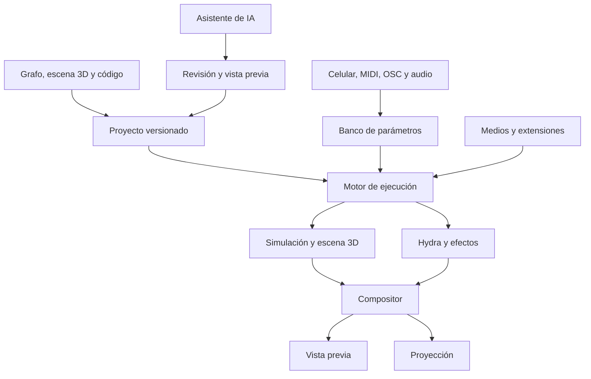

# Arquitectura de Zence R2

Zence R2 es un estudio audiovisual para hacer *live coding*, conectar medios y señales, construir escenas, simular sistemas y operar una proyección. El mismo proyecto debe abrirse en el navegador o en escritorio, y los controles publicados pueden operarse desde el celular durante un evento.

## Espacio de trabajo

| Vista | Qué se puede hacer |
| --- | --- |
| Grafo visual | Conectar fuentes, efectos, scripts, simulaciones, escenas, controles y salidas. Inspeccionar el valor o la vista previa de un puerto. |
| Escena 3D | Orbitar, seleccionar y transformar objetos con gizmos. Importar modelos y componer cámaras, materiales y luces. Ver en vivo cómo los nodos modifican la escena. |
| Código | Escribir módulos de JavaScript o TypeScript con entradas y salidas declaradas. Editar un patch Hydra o un shader, previsualizar el resultado y activarlo al estar listo. |
| Medios e inspector | Importar archivos, ver qué decodificó el equipo, administrar reemplazos y exponer parámetros en el grafo o en la superficie de control. |
| Proyección | Vista de programa a pantalla completa en un monitor o proyector. Control independiente de resolución, aspecto, cues y calibración. |
| Control móvil | Sliders, pads XY, botones, toggles y disparadores de cues en una página táctil abierta por QR. Lectura opcional de movimiento y miniatura de programa. |

La disposición inicial combina grafo y visor 3D en paralelo con un inspector. El panel de código se puede acoplar al pie. Seleccionar un nodo revela la entidad vinculada, y seleccionar la entidad revela los parámetros y nodos correspondientes. Las propiedades tienen una dirección de edición explícita. Si un nodo maneja la rotación, el inspector muestra la fuente y permite editarla o desconectarla. La cámara de autoría se mueve libremente mientras la cámara de programa sigue proyectando.

**Patch de referencia.** Importar un GLB de un escenario, colocar un plano como pantalla virtual y aplicarle una textura procedente de Hydra. Un nodo de análisis de audio modula el color y un emisor de partículas responde a un slider. El grafo envía la composición de la cámara de programa al proyector. Desde el celular se ajusta la intensidad de las partículas, se mueve un pad para modificar el efecto y se cambia de cámara con un botón. El operador ensaya el siguiente patch en la vista previa mientras el público sigue viendo el actual.

## Núcleo y límites de cada módulo

| Módulo propuesto | Contrato |
| --- | --- |
| `project` | Documento, validación, migraciones y operaciones editables. Define IDs estables para nodos, propiedades, archivos, scripts, escenas y superficies. |
| `engine` | Valida puertos, construye el plan de ejecución y dirige audio, control, simulación, render y eventos por sus relojes. Conserva el último plan válido si la compilación siguiente falla. |
| `render` | Administra cámaras, render targets, recursos GPU, composición, salidas y diagnósticos. Los nodos pasan identificadores con propietario de contexto y metadatos de textura. |
| `simulation` | Paso fijo, estado por instancia y adaptadores para partículas, comportamiento y física. Ofrece pausa, reset, avance manual, semilla y replay. |
| `media` | Catálogo, importación, decodificación, proxies, caché y productores vivos. Expone texturas, audio, geometría o eventos según el adaptador. |
| `controls` | Descriptores de parámetros, mapeos, suavizado y autoridad de la sesión. Recibe eventos del editor, celular, MIDI y OSC mediante el mismo contrato. |
| `scripting` | Compilación, API de puertos, ejecución aislada, diagnóstico y administración del estado al recargar. |
| `assistant` | Construye un contexto del proyecto, consulta proveedores configurables y valida operaciones propuestas antes de previsualizarlas. |
| `apps/studio` y `apps/bridge` | El estudio contiene editor, salida y cliente remoto. El puente local sirve la sesión LAN y amplía el acceso a protocolos, medios o dispositivos. |

El estudio inicial implementa tres tipos de nodo y un grafo visual en React con conexiones editables, inspector, visor Three.js y persistencia de proyectos JSON. El motor comparte la simulación de paso fijo con el ejemplo de terminal. La tabla describe los límites para crecer.

### Proyecto, puertos y relojes

- El proyecto serializa `schemaVersion`, definición de nodos y conexiones, escenas, scripts, medios vinculados, salidas y layouts de control. La posición de un nodo y el zoom del editor son metadatos de autoría. El estado de ejecución vive por sesión. Una edición válida crea una nueva revisión con deshacer y rehacer.
- Cada tipo de nodo declara ID, versión, puertos, parámetros, capacidades y ciclo de vida. Los primeros puertos serán escalar, vector, evento, textura, geometría o escena y datos de audio. Las conversiones explícitas sirven para escalar señales o cambiar su cadencia. Los puertos con una sola entrada rechazan conexiones múltiples.
- Compilar el grafo topológicamente y separar eventos puntuales de señales continuas. Definir un nodo de retardo de un tick o un fotograma para feedback, con memoria explícita. El runtime asigna identificadores de tick y activa un plan nuevo en un límite de frame.
- Procesar audio con Web Audio y usar AudioWorklet cuando haya DSP propio. Entregar al grafo envolventes o bandas FFT con marca temporal. Renderizar a la cadencia de presentación y procesar simulaciones en ticks fijos, inicialmente 60 Hz. Interpolar el estado en pantalla y acotar el trabajo tras una pausa. Separar simulaciones visuales GPU de los modos que requieran replay.
- Para repetir una sesión, guardar revisión, semilla, versión del motor y de cada adaptador, y cambios de control por tick. Validar el replay en el mismo entorno. La reproducibilidad entre plataformas se comprueba por backend y versión, con tolerancias cuando corresponda. [Notas de determinismo de Rapier](https://www.rapier.rs/docs/user_guides/javascript/determinism/)

### Herramientas iniciales

| Decisión | Responsabilidad y validación |
| --- | --- |
| TypeScript, React, Vite | Aplicación web y motor tipado compartido. Arrancar en un solo repositorio y dividir paquetes por las interfaces que realmente se implementen. |
| Rete.js + React | El estudio inicial usa un grafo ligero en React sobre el documento propio. Evaluar un adaptador Rete.js en un caso de 200 nodos y para selección múltiple o agrupación. React Flow queda como alternativa sobre el mismo documento. |
| Three.js + WebGL 2 | Visor, escena, cámaras, luces y salida de cámara a textura. Representar entidades mediante datos serializables y conservar objetos Three.js en el adaptador. |
| Hydra-synth | Fuente o efecto enchufable para código visual. Acoplar su avance al reloj de Zence cuando se use `tick` manual. Crear primero una prueba de puente por canvas. |
| Node.js + WebSocket | Primera sesión LAN y panel táctil servido por el puente local. Aislar el transporte del banco de parámetros. |
| Rapier, Tauri, Rust/WASM y WebGPU | Introducir Rapier cuando se necesiten cuerpos rígidos. Evaluar Tauri para compartir la interfaz en escritorio y validar su WebView por sistema operativo. Evaluar Rust/WASM en cuellos de CPU medidos y WebGPU con una prueba de cómputo o render de alto volumen. |

[Rete.js](https://retejs.org/docs/) · [Render con React](https://retejs.org/docs/guides/renderers/react/) · [Render targets de Three.js](https://threejs.org/manual/pages/rendertargets.html) · [Opciones de Hydra-synth](https://github.com/hydra-synth/hydra-synth) · [Disponibilidad de WebGPU](https://developer.mozilla.org/en-US/docs/Web/API/Navigator/gpu)

### Escenas, simulación y proyección

- Una entidad 3D tiene un ID, transformaciones, jerarquía y componentes serializados, por ejemplo geometría, material, cámara, luz o emisor. La selección se sincroniza por ID. La salida de cámara a textura permite componer una escena 3D dentro del grafo y usar una textura generativa en un material 3D.
- Probar los dos sentidos entre Hydra y Three.js. En contextos WebGL distintos, usar un puente por canvas o por frames y medir transferencia, latencia, sincronización y consumo de memoria; mantener el tamaño de la salida adaptable. Considerar recursos compartidos solo si el backend y la integración demuestran compatibilidad. Evitar leer píxeles a CPU en el flujo normal. Fijar el espacio de color, alfa y tiempo de cada textura. [Hydra con Three.js](https://github.com/hydra-synth/hydra#loading-external-scripts)
- Las simulaciones empiezan con partículas, atracción y repulsión. Ampliar con colisiones, cuerpos rígidos, agentes y campos de fuerzas cuando el paso fijo y el perfil de rendimiento estén verificados. Exponer posición, velocidad, colisiones y emisión como datos o eventos del grafo. Una prueba visual puede mostrar los vectores de fuerza y congelar un solo tick para depurar.
- Separar Preview y Programa dentro del compositor. La primera implementación usa una ventana de salida del mismo origen y transporta frames mediante captura de canvas o una vía equivalente validada, con un presupuesto medido. Un tab en segundo plano, la reproducción automática y el cierre de la ventana son casos de prueba. El modo escritorio podrá evaluar una ruta de salida nativa para evitar el coste de copia y controlar varios monitores.
- Para registrar una instalación, guardar el tamaño de la superficie, el orden de salidas, malla de deformación, máscaras y calibración por proyector. Implementar primero pantalla completa y patrón de calibración, luego deformación de cuatro esquinas, máscaras y, si el montaje lo pide, *edge blending* y varias salidas. Incorporar cues, fundido, congelar y negro de emergencia. [Referencias de mapeo de proyección](https://docs.derivative.ca/Projection_Mapping)

### Celular durante un evento

1. En el inspector, elegir **Publicar control** sobre un parámetro o cue. Asignar etiqueta, rango, página y widget, por ejemplo “Fuerza”, de 0 a 4, en un slider vertical. El panel lee los descriptores y se arma automáticamente. Un modo de mapeo permite vincular varios parámetros a un macro con curvas y rangos individuales.
2. El puente aloja tanto la página como el WebSocket en la red local. El QR abre un enlace con un código de enlace breve y de un solo uso. El operador autoriza la sesión y el teléfono recibe permiso para los controles publicados. Mantener el enlace táctil funcional en una LAN dedicada sin salida a internet. Habilitar HTTPS/WSS con certificado confiable si se necesitan sensores sujetos a contexto seguro o si se utiliza una red compartida.
3. El celular sincroniza el valor actual y envía cambios con secuencia y tipo. El puente valida sesión, permiso, rangos y frecuencia. Los sliders envían el último valor a frecuencia acotada, con envío final al soltar. Los cues usan IDs de evento y deduplicación. La app confirma valores aplicados, muestra reconexión y sincroniza la revisión publicada al volver a conectarse.
4. El estudio conserva el estado si se pierde el teléfono. El operador puede cambiar el control localmente o bloquear el panel. Prioridad de roles, comportamiento al desconectar (retener, volver al valor seguro o soltar), latencia y colas son visibles en pruebas de montaje.
5. TouchOSC y Open Stage Control pueden integrarse mediante un adaptador OSC/MIDI que resuelva nombres y parámetros del proyecto. Para el panel de Zence, los sliders y botones viajan por WebSocket desde el navegador del teléfono. El giroscopio requiere detección de capacidad, permiso donde corresponda y alternativa táctil. Reservar WebRTC para miniaturas o video cuando merezca la pena, con señalización y verificación de conectividad. [TouchOSC](https://hexler.net/touchosc) · [Open Stage Control](https://ammd.net/Open-Stage-Control) · [Permisos de orientación](https://developer.mozilla.org/en-US/docs/Web/API/DeviceOrientationEvent/requestPermission_static) · [Señalización WebRTC](https://developer.mozilla.org/en-US/docs/Web/API/WebRTC_API/Signaling_and_video_calling)

El banco de parámetros debe permitir también MIDI Learn, asignación de direcciones OSC y automatizaciones por timeline. La pantalla del celular puede empezar con feedback de valores, escena activa y próximo cue. Una miniatura de baja frecuencia es una extensión medible que debe poder apagarse.

### Scripting, IA y extensiones

- Darle al editor de código autocompletado a partir del registro de tipos y parámetros. Un nodo de script declara entradas, salidas y recursos. Su API recibe tiempo, tick y valores de entrada, y puede producir valores, eventos o instrucciones de render. Las entradas de grafo y las propiedades de escena son las mismas para código, interfaz y control remoto.
- Usar TypeScript/JavaScript para lógica, GLSL/Hydra para efectos iniciales y un adaptador separado para WGSL si se agrega WebGPU. El editor reconoce el script original del usuario. La equivalencia con nodos se limita a una DSL declarativa de ida y vuelta, con scripts arbitrarios representados como nodos opacos.
- Ejecutar lógica de terceros en worker terminable con API de mensajes, tamaño de payload y presupuesto por frame. Aislar su origen y limitar red, memoria y recursos mediante el diseño del host y su política de contenido. Para Hydra o shaders que requieren gráficos, validar compilación y límites de tamaño/tiempo en una vista aislada y probar recuperación del contexto GPU. El proceso que hace la proyección conserva la revisión de programa mientras se ensaya otra.
- La IA puede consultar por partes el proyecto autorizado completo, incluido el grafo, propiedades de escena, scripts, shaders, metadatos de medios y diagnóstico. Un extractor contextual permite elegir qué recursos se comparten con un proveedor remoto y admite un proveedor local. Archivos binarios y señales de cámara o micrófono se comparten solo si se incluyen explícitamente. El proveedor vive detrás de una interfaz común.
- El asistente devuelve una operación estructurada, por ejemplo crear un emisor, conectar el FFT al color, añadir una función de shader y publicar un slider. Aplicar la propuesta a una revisión de ensayo, mostrar diferencias, validar tipos, rutas y capacidades y previsualizar. Activar al aceptar el cambio. Las propuestas declaran la revisión base y pueden revertirse. Un script generado recibe el mismo aislamiento que los demás scripts.
- Versionar un SDK para registrar nodos, fuentes de medios, salidas y widgets. Un manifiesto declara capacidades, API compatible y migraciones. Empezar con extensiones incluidas y probar luego paquetes instalables con permisos explícitos. Diseñar un hook por protocolo para integrar TouchDesigner, Resolume u otras herramientas a través de OSC/MIDI y evaluar puentes de video nativos según plataforma.

### Medios y portabilidad

| Familia | Contrato de entrada | Ampliación prevista |
| --- | --- | --- |
| Imágenes | PNG, JPEG, WebP y GIF según decodificador. SVG importado como imagen, con recursos externos restringidos. | Secuencias, EXR/HDR y proxies. |
| Video y audio | Probar MP4 con H.264/AAC, WebM con VP8/VP9 y Opus, y audio WAV, MP3 y Ogg según plataforma. Clips, cámara, micrófono y pantalla con sus permisos. | Decodificadores adicionales, proxies y transcodificación opcional en escritorio. |
| 3D | GLB como primer formato. glTF empaquetando sus dependencias, y recursos de texturas ubicados por el catálogo. | OBJ, FBX, USD/USDZ, PLY y Gaussian splats mediante importadores y evaluaciones independientes. |
| Datos y señal | JSON/CSV, controles LAN, MIDI, OSC a través de puente y sensores web cuando sean compatibles. | Flujos de red o dispositivos externos por adaptador. |

Detectar contenedor, códec, tamaño, permisos y reproducción fluida en el dispositivo. Entregar un diagnóstico con alternativa cuando falle la decodificación. Conservar el original, su hash y los derivados con sus rutas relativas. Definir un manifiesto portable `.zence.json` y, después, un paquete `.zence` que transporte manifiesto, scripts y recursos incluidos. Los archivos enlazados externamente pueden relocalizarse por hash. La salida de grabación depende del navegador y del códec disponible. [Media Capabilities](https://developer.mozilla.org/en-US/docs/Web/API/Media_Capabilities_API) · [GLTFLoader](https://threejs.org/docs/pages/GLTFLoader.html)
